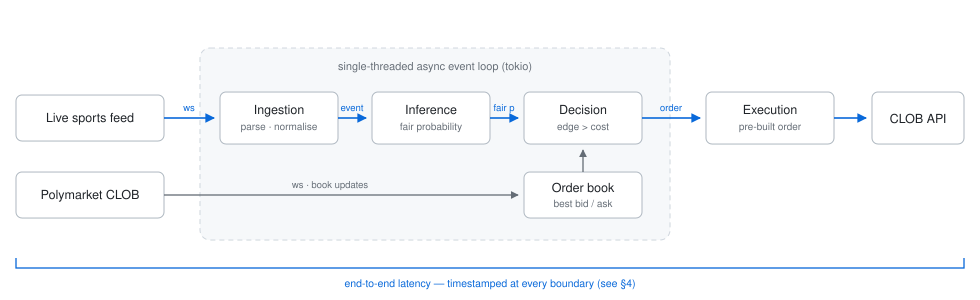
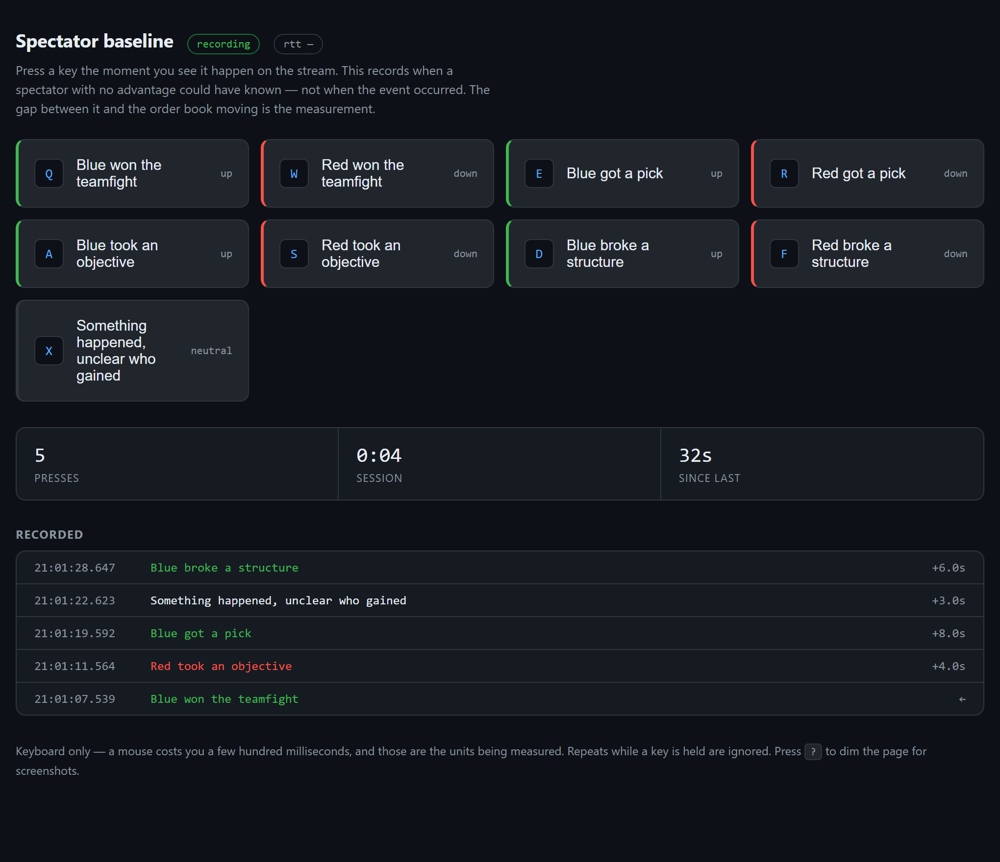
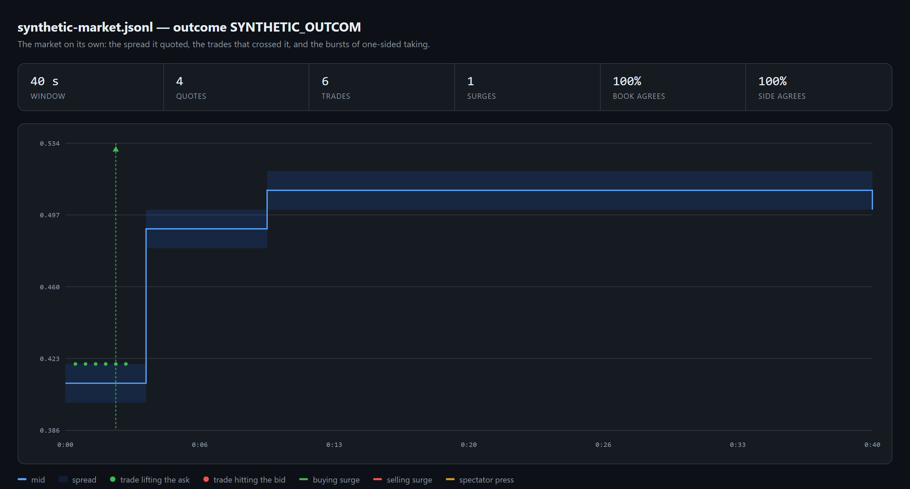

# Tick to trade

[](https://github.com/Vaypeee/tick-to-trade/actions/workflows/ci.yml)

> **Status: early development.** What exists is the measurement apparatus:
> three recorders, a replay that rebuilds the order book, an analysis that
> compares the market against a feed, against a spectator and against itself,
> and latency instrumentation of the recorder itself (§4). No live pipeline,
> no orders, and no result on the hypotheses yet.

A low-latency, event-driven inference pipeline in Rust, and the measurement
apparatus built to find out whether it is worth writing. The question is
whether prices on a live sports market lag the information that moves them —
first against a data feed, and now against the public broadcast itself.

This is an educational project in market microstructure. The goal is to build
the infrastructure, measure it, and then validate or reject each hypothesis
with data rather than argument. It runs in paper mode and places no real
orders.

## 1. Hypotheses

**H1 — the market is slow to price a public event.** When something happens in
a live game, traders take several seconds to react. A system that detects the
event, estimates the new fair probability and sends an order faster than the
market reprices would have a measurable edge window.

H1 has a hard dependency: a data feed faster than the market. Measurement
killed the cheap ones — see §5 — and the paid ones publish latency figures
that are not comparable with each other. H1 is on hold until a feed is found
and measured.

**H2 — the order book is itself the fastest public signal.** Somebody always
sees the game before the broadcast does: people in the venue, players, anyone
on a lower-latency feed. If they trade, their flow moves the book *before* the
public stream shows the event. Then the book is not the thing being raced — it
is the detector, and it costs nothing.

H2 inverts the problem and removes the dependency. It is also directly
testable, because the comparison it needs is not a vendor feed but an ordinary
spectator: somebody watching the public broadcast with no advantage at all.
That baseline is recorded by hand (§7), and the distance between it and the
book moving is the quantity that decides whether anything here is tradeable.

The questions, in the order they can actually be answered:

- By how much does the order book lead an ordinary spectator?
- Does an aggressive move continue far enough to clear fees and spread, or is
  the information already fully in the price by the time it is visible?
- How long does the repricing window last, and what latency captures it?
- Does any of it survive slippage on books this thin?

## 2. Architecture

<p align="center">
  <picture>
    <source media="(prefers-color-scheme: dark)" srcset="assets/architecture-dark.svg">
    
  </picture>
</p>

Solid is what runs. Dashed is what does not, and deliberately so: until the
measurements say a fast trading path is worth building, building one would be
the mistake this project exists to avoid.

**What runs.** Three recorders write whatever their feed shows, verbatim, one
JSON object per line, stamped on two clocks. A replay rebuilds the order book
from the snapshot and the deltas and feeds everything downstream: the analysis
that compares the market against a feed, against a spectator and against
itself; the paper trader that applies the rules with their real costs; the
dashboard that draws the lot on one timeline.

**What does not.** Inference, execution and the live hot path. The decision
layer is the exception: the rules exist and are tested offline, because rules
can be checked against recordings for nothing, while an execution path cannot
be checked against anything but money.

- **Recorders** — one process per feed, each timestamping before it parses,
  so no recorder work lands inside the measurement.
- **Recordings** — raw frames, never normalised on the way in. Which fields
  matter is one of the things the project does not know yet, and a raw
  recording can be re-analysed while a parsed one cannot.
- **Replay** — rebuilds the book and cross-checks itself against the touch the
  exchange reports, so the reconstruction the live pipeline will depend on is
  known to be right rather than assumed.
- **Decision** — trade only if the expected move clears the full round trip:
  the spread crossed twice, plus fees on both legs.

## 3. Design choices

| Choice | Rationale | Measured impact |
|---|---|---|
| Rust | No GC pauses, predictable tail latency | not measured |
| Single-threaded event loop | No context switches or lock contention on the hot path | not measured |
| Pre-built orders | Keeps serialisation and signing off the hot path | not measured |
| VPS region selection | Network is expected to be the largest fixed cost | not measured |

Each row is a hypothesis about where the latency goes. The point of the project
is to replace "not measured" with a number, and to drop the choices that turn
out not to matter.

## 4. Latency budget

Measured, not estimated. Every stage of the recorder is timed into an HDR
histogram and the percentiles are printed at the end of a run, so the figures
below are reproducible by running it.

What is measured is the stretch this process is answerable for: a frame
leaving the socket to the line reaching the operating system. The network
before it and the disk after it are not ours to claim.

| Stage | p50 | p99 |
|---|---|---|
| Parse — validate the frame as JSON | 2.4 µs | 23.5 µs |
| Enqueue — hand it to the writer | 3.0 µs | 16.5 µs |
| Format — record to a line | 1.8 µs | 13.5 µs |
| Write — line to the operating system | 0.1 µs | 2.9 µs |
| **Total — socket to written** | **19.4 µs** | **120.5 µs** |

*Sample: 48 frames over 90 s on a liquid market, no stalls, release build.*

Each task keeps its own histograms and they are merged once at the end. A
shared, locked histogram on the hot path would have measured the contention it
introduced.

The gap between the exchange timestamp on a frame and our receipt of it reads
about 460 ms, consistently. That is **not** a network latency: it spans two
machines, so it is the delay plus however far the two clocks disagree, and
nothing here can separate them. Checked against HTTP `Date` headers, which
only resolve to the second, the local clock sits somewhere inside half a
second of true — consistent with the gap being mostly clock offset. It does
not affect the measurements in §5, because recordings compared against each
other are made on the same machine and share whatever offset there is; it
would only matter against an external timestamp.

The stages an actual trading path would add — inference, decision, order to
acknowledgement — do not exist yet, and no figure is invented for them.

## 5. Results

The hypothesis is not yet tested: that needs a sports feed that actually shows
events, and no such feed has been found. Three things have been measured.

**The book reconstruction is correct, and the check earns its keep.**
Replaying a 17-minute recording of a live Serie A market, the order book
rebuilt from the snapshot and the deltas agreed with the exchange's own
`best_bid` and `best_ask` on **100% of 14,866 updates**. The live pipeline
will price the spread it crosses with this same code, so this is the one piece
that is now known to be right rather than assumed to be.

The check then caught something on a second recording, where agreement fell to
67%. The market channel pushes price changes for **every** outcome of a
market, but only sends an opening snapshot for the outcomes subscribed to —
and a book cannot be rebuilt from deltas alone. The replay had been applying
changes to an outcome it had never seen a baseline for, producing a book that
looked plausible and quoted a touch that did not exist. Those deltas are now
dropped and counted rather than guessed at, which restored 100% agreement and
turned a silent error into a line of output. Subscribe to every outcome of a
market.

**A free scoreboard endpoint is too slow to be the input.** Polling ESPN at
1 Hz during a live match, the response changed only every 10–20 seconds, with
HTTP round-trip at a median 87 ms: the ceiling is the source cadence, not the
transport. A feed with 10-second granularity cannot beat a market that
reprices in seconds, however fast the system behind it is.

**Most of what a feed shows is not an event.** Over 17 minutes of a live
match, the same endpoint produced 23 changes and not one of them was a score:
they were bookmaker odds and the match clock. This matters more than it looks.
Run naively, the analysis credited five of those changes with the same single
market move and reported a tidy distribution of lags from 23 s to 114 s — all
of it an artifact. Each market move is now claimed by exactly one observation,
the nearest before it, and contested matches are reported rather than counted.
A noisy feed will otherwise manufacture whatever result it is asked for.

*Sample: one match, one market, 1,020 s, 7,649 market frames, 24 stored feed
responses, no sequence gaps and no recorder stalls.*

Still to measure, with the sample size and the method stated:

- the observed repricing window, once a feed shows events,
- captured edge as a function of end-to-end latency,
- the net result after fees and slippage,
- whether the hypothesis is validated, rejected, or holds only in some
  conditions.

A negative result is a result and will be published as one.

## 6. Known limits

- The latency of the data feed itself is a hard floor, and it is not under the
  system's control.
- Liquidity on live markets may be too thin for the edge to scale, even if it
  exists.
- Platform rules (order delays, terms of use) can remove the edge entirely, and
  can change at any time.
- Paper-mode results overstate live performance: they assume fills that a real
  order book may not provide.

## 7. Running it

```bash
cargo build --release
cp config.example.toml config.toml
```

### Recording

The recorders are the part that works today, and they are deliberately the
first thing built: the hypothesis above is answerable from recordings alone,
without a fast system. Recordings are also what makes every later benchmark
reproducible, which a live feed can never be.

Record both feeds at once, in two processes, so the two can be aligned:

```bash
cargo run --release --bin record -- --feed polymarket &
cargo run --release --bin record -- --feed sports &
```

**The market.** The CLOB market channel is public, so no credentials are
needed. Put the outcome token ids you want in `polymarket.asset_ids` — they
are the `clobTokenIds` of a market on the
[Gamma API](https://gamma-api.polymarket.com/markets?closed=false&limit=5).

**The sports feed.** No provider is hard-coded. Vendors publish latency
figures that are not comparable with each other and that none of them measures
the same way, so `sports_feed.url` points at whatever source is being
evaluated and the recording measures its lag directly, against the same clock
as the market.

Each run writes `data/recordings/<feed>-<unix-secs>.jsonl` plus a `.meta.json`
sidecar describing what was recorded and with which clocks. One JSON object
per line:

| Field | Meaning |
|---|---|
| `seq` | Dense counter; a gap means a lost record, not a quiet feed |
| `t_mono_ns` | Monotonic nanoseconds since start — use this for durations |
| `t_unix_ns` | Wall clock at receipt — the only clock comparable across recordings |
| `kind` | `data` (a websocket frame), `poll` (a changed HTTP response), `text`, or `control` |
| `t_request_*` | On a poll: when the request went out, bounding the change |

Both clocks are kept because neither is enough alone: the monotonic one cannot
jump when NTP steps the system clock, and the wall clock is the only one that
lines a market recording up with a sports recording taken by another process.

A polled source cannot say when something happened, only that it had happened
by the time you asked. Every `poll` record therefore carries `t_request_*` as
well, and `unchanged_polls` — the number of identical responses before it. The
change happened somewhere inside that window, and the record says how wide it
is instead of assuming it away.

Only changed responses are stored; unchanged ones become a periodic
`unchanged` heartbeat, so a quiet recording is never mistaken for a dead one.
Connection lifecycle is recorded the same way. If a writer ever falls behind
its feed, the run reports a non-zero `stalls` count: those recordings measure
the recorder as much as the market.

### Recording the spectator baseline

H2 needs a reference point, and the honest one is a person watching the public
broadcast with no advantage. `--feed labels` serves a local page whose keys
stamp the moment you saw something happen:

```bash
cargo run --release --bin record -- --feed labels
```

<p align="center">
  
</p>

A press is **not** the instant the event occurred. The stream runs seconds
behind and a human needs a few hundred milliseconds more. That is the point:
it marks when public information reached somebody with no edge, which is
exactly the baseline H2 is measured against.

Each button declares a `direction`, so the analysis can separate a market move
that agrees with the event from one that does not — a market moving the wrong
way is noise, not a reaction. The browser sends its own clock reading with the
press, kept separate from the moment the server wrote it down; on this machine
the gap between the two measured 2–4 ms, well inside human reaction time but
recorded rather than assumed.

The page is unauthenticated and its presses are written to disk, so it binds
to loopback and the configuration refuses anything else. Keys only — a mouse
costs a few hundred milliseconds, and those are the units being measured.

### Analysing

Both measurements run from the same tool, against the same replayed market.

**H2 — how far ahead of a spectator was the book?**

```bash
cargo run --release --bin analyse -- \
  --market data/recordings/polymarket-<timestamp>.jsonl \
  --labels data/recordings/labels-<timestamp>.jsonl
```

For each key press it reports the signed offset to the nearest market signal.
Negative means the market moved first, and that distance is the advantage
somebody already had over you.

Two signals are measured separately, because they answer different questions:

- **Price moves** — the mid shifting by at least `--min-move`. This is the
  *consequence* of informed trading.
- **Aggressive order flow** — net liquidity taken over a trailing window,
  past `--surge-size`. This is the *cause*, and it is visible earlier and more
  sharply than the price it eventually moves.

Trades are classified as buyer- or seller-initiated by where they printed
relative to the touch, not by trusting the `side` field on the message. Both
readings are kept and the agreement rate is reported — the same discipline as
rebuilding the book instead of taking the exchange's `best_bid` on faith. A
field whose meaning has been assumed rather than checked is a quiet way to be
wrong for months.

Netting is deliberate: two sides trading with each other is not somebody
acting on information, so only the imbalance counts. The window trails rather
than looks forward, because a forward window can step past an offsetting trade
and report the other side on its own — a buy and a matching sell would come
out as a sell surge. A burst reports once, not once per trade in its tail.

**Does following the flow pay, and how late can you be?**

```bash
cargo run --release --bin analyse -- \
  --market data/recordings/polymarket-<timestamp>.jsonl \
  --fee-bps 0 --hold-secs 30
```

With no comparison file, the market recording is studied on its own. Every
detected surge is replayed as a round trip — enter after a reaction delay,
hold, close — and the result is reported against a ladder of delays. That
curve is the whole question: if the edge survives being thirty seconds late,
speed was never the constraint and the effort belongs in the model instead.

Three pessimistic choices, because each is a way a backtest talks itself into
a strategy that loses money live:

- **Both legs cross the spread.** Buying pays the ask, selling receives the
  bid. A mid-to-mid study books half the spread twice as profit nobody earns.
- **Entry is deliberately late.** You cannot trade at the instant of the
  surge, so the delay is a parameter rather than an assumption.
- **Size is ignored, and the result says so.** Every fill is at the touch,
  which a thin book will not absorb, so the number is an upper bound.

`--fee-bps` is charged on each leg; leave it at zero only if the venue really
takes nothing.

**H1 — how long after a data feed did the market follow?**

```bash
cargo run --release --bin analyse -- \
  --market data/recordings/polymarket-<timestamp>.jsonl \
  --sports data/recordings/sports-<timestamp>.jsonl
```

Both replay the market recording into a mid-price series by rebuilding the
order book from the snapshot and the deltas.

Five choices in it are worth stating, because each one is a way the number
could have been flattered:

- **Alignment is on wall clock, never on the monotonic clock.** Each recorder
  starts its own monotonic origin, so comparing those across two files yields
  a confident, meaningless offset.
- **Polling uncertainty stays visible.** A change is bounded by the request
  that found it and the response that carried it, so every lag is reported as
  a range rather than a point.
- **Events the market ignored are excluded, not counted as zero.** They are
  reported separately. Averaging them in as instant reactions would invent an
  edge that is not there.
- **Moves are extracted from the price series alone**, before any press or
  feed change is looked at. A move set chosen while looking at the events it
  will be compared against is not evidence of anything.
- **The search around a press is symmetric.** Looking only backwards would
  find a lead whenever the market happened to move at all, and would hide the
  case where the market moved *after* you — which is the result that sinks the
  hypothesis, and therefore the one most worth being able to see.

A press also carries the direction its event should have pushed the price, so
a move the wrong way is reported as disagreeing rather than counted as a
reaction.

The rebuilt book is cross-checked against the `best_bid` and `best_ask` the
exchange reports on every delta, and the agreement rate is printed. The live
pipeline will depend on this same reconstruction to price the spread it is
about to cross, so a disagreement is better found here, against a recording,
than later against money.

`--min-move` sets what counts as a move (default 0.02 of probability),
`--window-secs` how far either side of a press to look for the nearest one,
and `--horizon-secs` how long to wait for the market to follow a feed change.
`--path` narrows which parts of a polled document count as events; with none,
every change counts, and the tool prints which paths churn most, so the choice
can be made from evidence about the feed rather than a guess.

### Paper trading a recording

```bash
cargo run --release --bin paper -- \
  --market data/recordings/polymarket-<timestamp>.jsonl
```

Replays the recording through the rules in `[decision]` and `[execution]`:
signals from aggressive flow, entries that cross the spread, exits that cross
it back, position limits, staleness, and a refusal to trade a book too wide or
too thin.

The one thing it cannot know is what a signal is worth, so it does not guess.
The expected move is swept across a ladder and the table reports what each
assumption would have produced:

```
        move  trades         net     won    drawdown
       0.020       0           -
       0.030       0           -
       0.050       1      +0.800    100%       0.000

  Break-even sits between 0.050 and the row above it
```

That is a more useful answer than any single number: it says how large a move
a model would have to predict, correctly and on average, before these rules
stop losing money. Refusals are reported by rule, so when nothing trades it is
clear which constraint did it rather than leaving a silent zero.

Positions are sequential — one at a time, opened on a signal and closed after
the hold — because a backtest that can hold several overlapping positions
hides which signal earned what.

### Looking at a recording

```bash
cargo run --release --bin dashboard -- \
  --market data/recordings/polymarket-<timestamp>.jsonl \
  --labels data/recordings/labels-<timestamp>.jsonl
```

Writes one self-contained HTML file: the spread the book quoted, the trades
that crossed it, the bursts of one-sided taking, and the moments a spectator
on the public broadcast knew something. Where a press sits to the right of a
surge, the book moved first — which is the whole question, drawn instead of
tabulated.

<p align="center">
  
</p>

*Shown on the synthetic recording in `tests/fixtures`, because it has a clear
story: six trades lift the ask, then the touch steps up twice.*

It is a **replay, never a live view**, and that is a measurement decision
rather than a missing feature. A chart of the book beside the labelling page
would turn an independent observation into an echo of the thing it is meant
to be measured against, and nothing in the recording would afterwards show
that it had happened. The labeller stays blind on purpose.

Prices are drawn as a staircase: a quote holds until the next replaces it, so
joining two with a sloped line would draw prices the book never showed —
tidier, and wrong.

### Checking the setup

```bash
cargo run --release
```

The command named after the crate does not run a pipeline, because there is
no pipeline: until the measurements justify building one, there should not be.
It checks the configuration instead and says what is ready — how many outcomes
are subscribed, whether the labelling page has keys bound, what rules the
decision layer would apply, how many recordings are already on disk — and
names what is still missing before a recording can start.

That is worth a command of its own because a mistake in the configuration
only shows up as an empty recording, and the match is over by then.

`config.toml` holds credentials and is git-ignored, as is `data/`; only
`config.example.toml` is committed.

## 8. Run book for a live match

What to do, in order, while a game is on.

**0. Check the setup.**

```bash
cargo run --release
```

**1. Find the market and its outcome token ids.**

```bash
cargo run --release --bin markets -- --search "league of legends"
```

```
Will T1 win on 2026-11-03?
  liquidity 296216   volume 24h 344860   spread 0.010
  asset_ids = [
    "594168809660711622466685284175436863367800796362014020567734896849",  # T1
    "529368772184831086972124053157541862609622297808201424243087280694",  # Gen.G
  ]
```

Paste both ids. **Both**: the channel pushes price changes for every outcome
of a market but only snapshots the ones subscribed to, so recording one side
leaves half the deltas with nothing to apply them to. The outcome you list
first is the one label directions refer to, so put the side you think of as
"blue" there.

**2. Start the recorders, one process each, before kickoff.**

```bash
cargo run --release --bin record -- --feed polymarket &
cargo run --release --bin record -- --feed labels &
```

**3. Open http://127.0.0.1:7878/ and keep it focused.** Press keys as you
watch. Keyboard only. A reload is safe: the page asks the server for what it
already recorded.

**4. Check the run before trusting it.** At the end, both processes report
`stalls=0` and `reconnects`. A non-zero stall count means the recorder was in
the way of its own measurement.

**5. Analyse.** Add `--outcome <id>` if the side you want is not the one
listed first in the recording.

```bash
cargo run --release --bin analyse -- \
  --market data/recordings/polymarket-<timestamp>.jsonl \
  --labels data/recordings/labels-<timestamp>.jsonl
```

One game will not settle anything. Teamfights worth labelling happen a few
times per game, so a usable sample is several games. Give the analysis all of
them at once and the presses are pooled into a single distribution rather than
left as four inconclusive reports:

```bash
cargo run --release --bin analyse -- \
  --market data/recordings/polymarket-<game1>.jsonl \
  --labels data/recordings/labels-<game1>.jsonl \
  --market data/recordings/polymarket-<game2>.jsonl \
  --labels data/recordings/labels-<game2>.jsonl
```

Each recording is reported on its own first, then pooled. The tool still says
when there are too few matched presses to read anything into the percentiles.

## 9. Checks

```bash
cargo fmt --all --check
cargo clippy --all-targets -- -D warnings
cargo test --all-targets
```

CI runs all three on every push, with warnings promoted to errors: a lint that
only fails on one machine is a lint nobody fixes. Nothing in the test suite
touches the network — every test runs against fixtures or hand-built inputs —
which is what makes them worth running on a machine that has never seen a live
market.

A second job builds against the `rust-version` in `Cargo.toml`, reading the
number out of the manifest rather than repeating it. That field was wrong
until CI was written: it claimed 1.85 while the code uses let-chains, which
need 1.88. An unchecked minimum version is a number somebody typed once.

## 10. Roadmap

Ordered so that the hypothesis is tested before the fast system is built.

- [x] Recorder for the Polymarket CLOB market channel
- [x] Recorder for a sports feed, provider-agnostic, measuring its own lag
- [ ] A sports feed fast enough to be worth trading on, found by measurement
- [x] Offline analysis: replay, book reconstruction, lag measurement
- [ ] H1 end to end, once a feed fast enough to test it exists
- [x] Spectator baseline: hand-stamped from the public broadcast
- [x] Tool to measure the lead of the book over the spectator baseline
- [ ] The H2 measurement itself, over enough matches to mean something
- [x] Aggressive-flow detection: net taking over a trailing window
- [ ] Validation of that signal against labels from real matches — fills §5
- [x] Continuation study: what following a surge pays, against reaction delay
- [x] Replay dashboard: book, flow and spectator presses on one timeline
- [ ] A live operator view — for the pipeline, never beside the labeller
- [ ] Order book state in the live pipeline, reusing the replay reconstruction
- [x] Latency instrumentation of the recorder (HDR histograms) — fills §4
- [ ] The same instrumentation along a live trading path, once one exists
- [ ] First fair-value model, however crude
- [x] Decision layer with an explicit fee and spread model
- [x] Paper execution and simulated PnL over a recording
- [ ] Feed comparison, measured; VPS regions only once latency is the binding constraint
- [ ] Better fair-value model, measured against its latency cost

## Disclaimer

This repository is published for educational purposes. It is not financial
advice, and it is not an invitation to trade. Anyone running it is responsible
for complying with the terms of service of the platforms involved and with the
law in their own jurisdiction.

## License

MIT — see [LICENSE](LICENSE).
